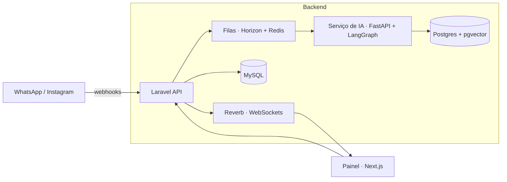

# Atenda — Atendimento com IA para WhatsApp e Instagram

> SaaS multi-tenant de atendimento: uma caixa de entrada única onde a IA responde na hora e a equipe humana assume quando precisa.

> **Repositório vitrine.** O código-fonte é proprietário (FML Tech) e fica privado. Aqui estão o problema, a arquitetura e as decisões técnicas. Demonstração técnica disponível sob solicitação.

## O problema

Empresas que vendem por WhatsApp e Instagram perdem leads por demora na resposta, distribuição manual entre atendentes e falta de histórico. O Atenda centraliza os canais, responde com IA treinada na base de conhecimento da empresa e transfere para um humano no momento certo.

## O que o sistema faz

- **Caixa de entrada unificada** (WhatsApp e Instagram) com atualização em tempo real
- **Agente de IA** que responde com base na base de conhecimento da empresa (RAG) e decide quando escalar para humano
- **Classificação automática** de sentimento e intenção (ex.: intenção de pagamento) com saída estruturada
- **Regras de transferência** configuráveis da IA para a equipe
- **Distribuição de leads** entre atendentes, com redistribuição automática de conversas paradas
- **Funil comercial (CRM)** com etapas, negócios e histórico de mudança de etapa
- **Follow-up automático** de leads sem resposta e lembretes para a equipe
- **Integrações**: Google Calendar (agendamento), anúncios da Meta, webhooks de saída e ferramentas MCP
- **Painel de métricas** consolidado diariamente
- **Log de decisões da IA**, para auditar por que ela respondeu ou transferiu

## Arquitetura

- **Laravel** é dono dos dados de negócio e o único serviço exposto ao frontend.
- O **serviço de IA em Python** só é chamado pelo Laravel, na rede interna, com token de serviço.
- O agente é um **grafo LangGraph** (recuperar → aplicar regras → gerar → escalar ou responder), com checkpoint de estado por conversa.
- A entrega de mensagens, a indexação da base de conhecimento e as chamadas à IA rodam em **filas**, sem travar a requisição.
- O painel recebe novas mensagens por **WebSockets** (Laravel Reverb).

## Destaques técnicos

- Grafo do agente testado com LLM e retriever falsos injetados, sem depender de API externa nos testes
- Base de conhecimento com indexação e remoção assíncronas de artigos
- Stack de desenvolvimento e produção em Docker Compose, com bancos e Redis acessíveis só pela rede interna
- Testes automatizados em PHPUnit, pytest e Vitest
- Desenvolvimento orientado a especificação (requisitos → design → tarefas)

## Stack

| Camada | Tecnologias |
|---|---|
| Backend | PHP 8.2, Laravel, Sanctum, Horizon, Reverb, Redis |
| IA | Python, FastAPI, LangGraph, OpenAI, pgvector |
| Frontend | Next.js, React, TypeScript |
| Infra | Docker, Docker Compose, Nginx, MySQL, PostgreSQL |

## Status

Em operação: uma versão desta tecnologia já roda em cliente real. A versão SaaS multi-tenant está pronta para novos clientes.

## Autor

**Felipe Lopes** · Full-stack e fundador da [FML Tech](https://fmlsoftware.com.br)
Arquitetura, backend, serviço de IA e integração com os canais.
